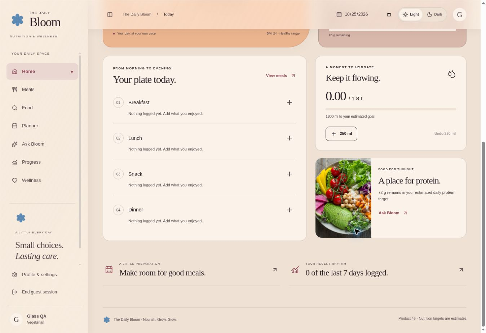
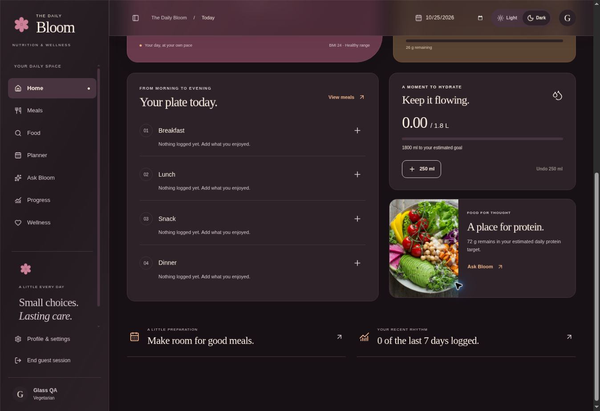
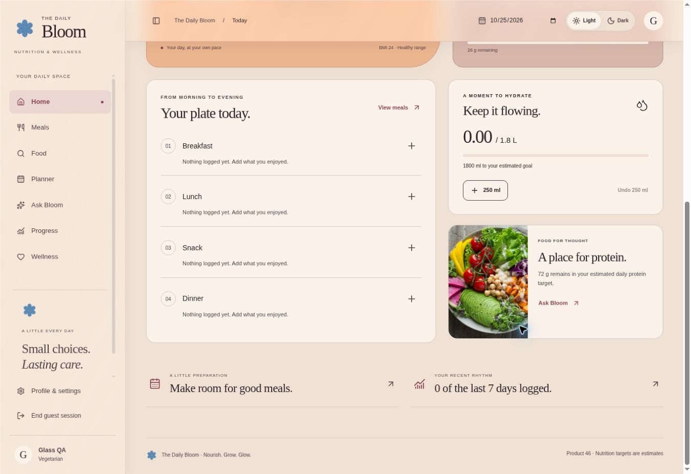
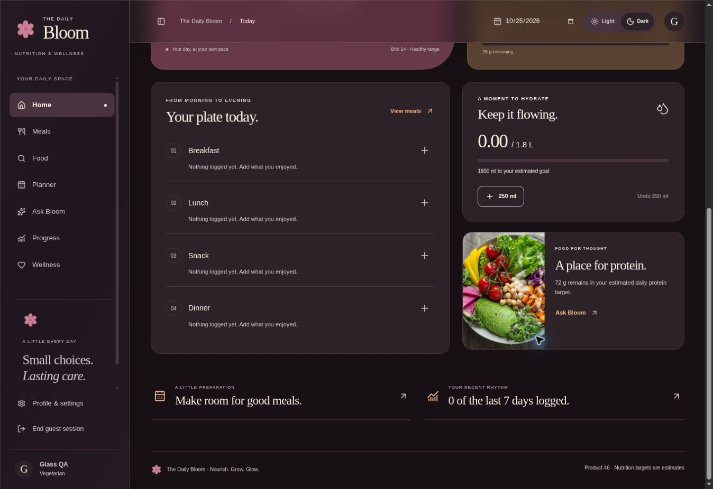

# Scrolling glass verification

Rollback: published version 15 / source `9234b77a9f627f222d7251c951fa022bc612591e`.

## Diagnosis

Inspected the actual local Chrome preview DOM and computed styles, using the current source and an isolated local guest profile. Initialized only the local preview database using the existing migration; production data/schema were not touched.

The reported complete absence of a backdrop could not be reproduced in this browser: the original header already computed to rgba(251,242,233,.55) / rgba(45,34,40,.55), with blur(18px) saturate(1.25). Content genuinely scrolled beneath it. Its ancestors had overflow:visible, opacity:1, filter:none, and no backdrop filter. The main surface had isolation:auto; the outer app had isolation:isolate, but this did not prevent same-app content from appearing behind the header. The scroll container was HTML. No opaque header child or blocking pseudo-element was found.

The observable issue was excessive material opacity rather than incorrect sticky placement. The 55% tint, additional reflection layer and diffusion muted the background silhouettes. Changed the existing glass definitions in place: Light tint 40%, Dark tint 38%, blur20px/saturate140%, reflection alpha .035/.02, edge .35 white / .16 warm linen. No additional blur overrides, positioning changes, negative spacing, duplicated content or artificial scrolling layers were added. Sidebar uses the same material. Unsupported-browser opaque fallbacks remain.

## Actual browser verification

Tested local preview in Chrome at 1348×926. Switched both themes and scrolled Home with real wheel input. At the captured after position, scrollY=684; header rect top=0/bottom=82; featured card rect top=-254/bottom≈133. Thus the card physically crossed behind the entire header. Its fig/apricot and bronze silhouettes were visible and diffused through the glass. Header children computed filter:none and opacity:1 and stayed visually sharp.

Checked sidebar scrolling and navigated to Meals; the existing active marker moved correctly. No layout or scrolling changes were introduced. The browser's native calendar control accepted focus, but its popup did not render in this environment, so calendar-popup clipping is unverified. Mobile/tablet and frame-time/lag measurements are unverified. No app-origin console error was observed in the inspected recent error log; the browser extension logged its own metadata errors.

## Checks and scope

All 54 regression tests passed, production build passed, and git diff --check passed. Runtime changes are exclusively in the existing scoped navigation-glass block of app/globals.css. tests/studio-ui.test.cjs updates its expected material values. This report and four screenshot files are evidence only, outside public assets. No React, events, data, state, API, database schema, palette, dashboard styling, active highlight, spacing, dimensions, logo, animation, dependency or rendering engine changes.

## Before

## After — coloured cards crossing behind the sticky header

